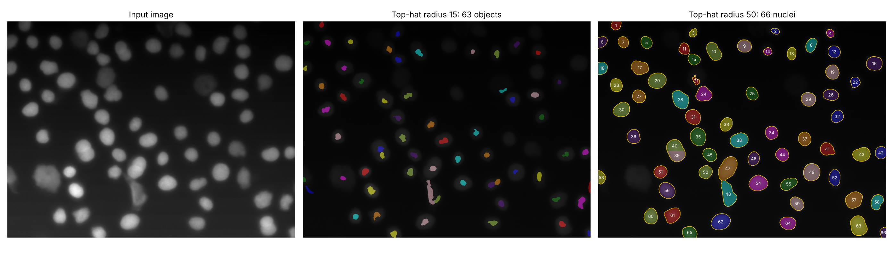

# Nucleus segmentation with top-hat filtering and watershed

Automatic segmentation and shape measurement of cell nuclei in a fluorescence microscopy image with
uneven illumination (`normal40_var_refl.png`, 1360 × 1024 px), using classical image processing in
Python (scikit-image, SciPy). The pipeline mirrors the MATLAB toolbox workflow: `imtophat`,
`imbinarize`, `bwdist`, `watershed`, `regionprops`.



*Left: input. Middle: the same pipeline with a top-hat disk of radius 15 px, smaller than the nuclei.
It erases their interiors and leaves small fragments. Right: radius 50 px, which finds 66 nuclei.*

## Pipeline

| Step | Function | Why |
|---|---|---|
| Gaussian smoothing, σ = 2 px | `filters.gaussian` | suppress pixel noise before thresholding |
| White top-hat, disk r = 50 px | `morphology.white_tophat` (≈ `imtophat`) | remove the uneven background; the disk must be **larger** than a nucleus (median diameter ≈ 65 px) |
| Otsu threshold | `filters.threshold_otsu` (≈ `imbinarize`) | separate nuclei from background |
| Clean-up | `remove_small_objects`, `binary_fill_holes`, `binary_opening` | drop specks, fill dark holes inside nuclei |
| Distance transform + maxima ≥ 20 px apart | `distance_transform_edt` (≈ `bwdist`), `peak_local_max` | one marker per nucleus |
| Marker-based watershed | `segmentation.watershed` | split touching nuclei |
| Measurements | `measure.regionprops_table` | area, perimeter, axis ratio, eccentricity, solidity, intensity |

## Results

66 nuclei segmented. Per-nucleus measurements are in
[`results/nuclei_features.csv`](results/nuclei_features.csv).

| Feature | Mean | Std | Min | Median | Max |
|---|---|---|---|---|---|
| Area (px²) | 3282.8 | 1308.6 | 816 | 3145.5 | 7087 |
| Perimeter (px) | 213.4 | 45.2 | 113.7 | 211.8 | 335.1 |
| Major / minor axis | 1.28 | 0.21 | 1.05 | 1.22 | 2.06 |
| Eccentricity | 0.58 | 0.14 | 0.31 | 0.57 | 0.87 |
| Solidity | 0.98 | 0.02 | 0.80 | 0.98 | 0.99 |

The extreme values point to segmentation errors, not unusual nuclei. Nuclei 47 and 48 (the largest
area, 7,087 px², and the highest axis ratio, 2.06) are touching nuclei that the watershed did not
split. Nucleus 21 (lowest solidity, 0.80) is a small irregular fragment.

## Run it

```bash
pip install -r requirements.txt
python segment_nuclei.py --compare-radius 15     # writes figures/ and results/
python segment_nuclei.py --image other.png --tophat-radius 40
python -m pytest -q tests                        # synthetic images with known nuclei
```

## Limitations

- **No ground-truth masks** for this image, so accuracy (e.g. Dice or IoU) is not measured. The
  tests check the pipeline on synthetic images with a known number of nuclei instead.
- **Faint nuclei are missed.** A few very dim, out-of-focus nuclei fall below the global Otsu
  threshold. A local or adaptive threshold would recover some of them.
- **Touching nuclei.** Some pairs that touch over a long boundary stay merged.
- **Image-specific parameters.** The top-hat radius and marker distance are tuned to this image's
  scale and must be adjusted for other magnifications.
